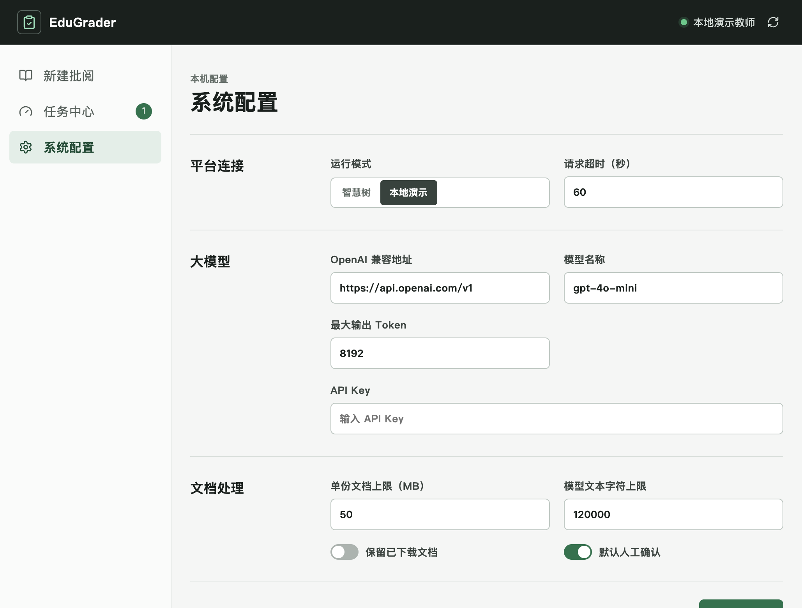
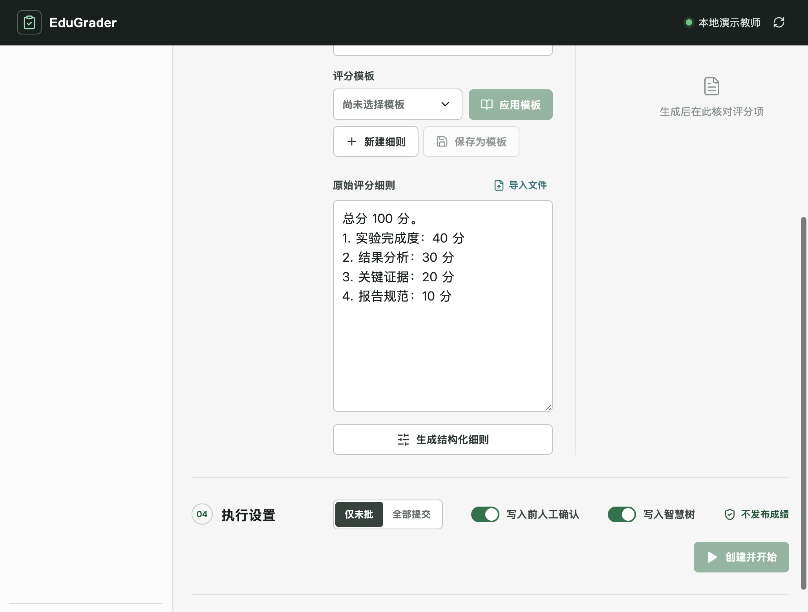
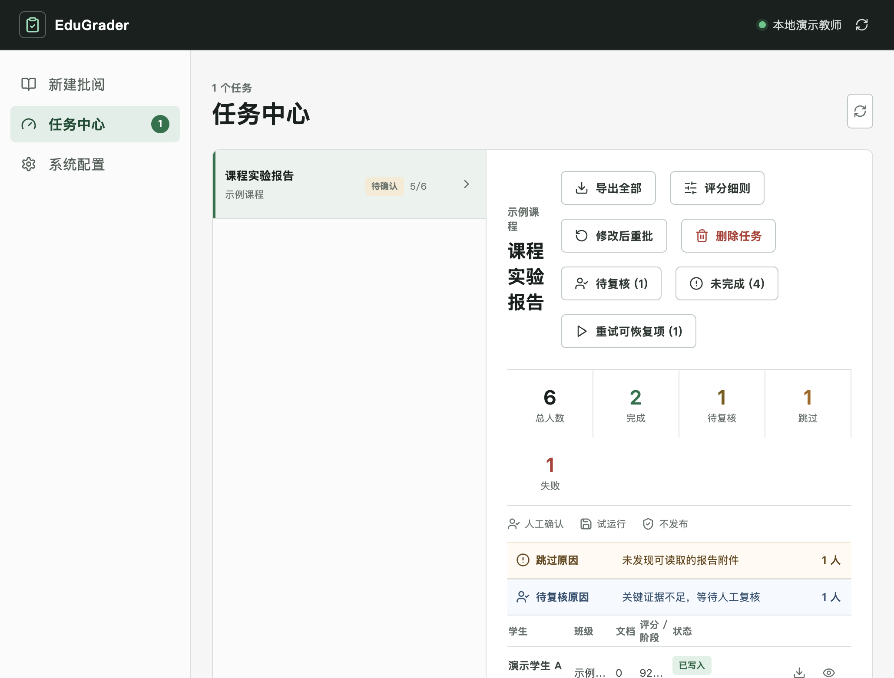

# EduGrader

EduGrader 是一个在本机运行的智慧树作业批阅工具。它读取学生提交的
PDF 或 DOCX 报告，调用 OpenAI 兼容大模型生成评分，并可将成绩写回为
未发布状态。

## 安全边界

- 只处理作业，不读取或操作考试。
- 不保存智慧树密码，登录和验证码均在智慧树官方页面完成。
- 不调用成绩发布接口。
- 每次写入前都会检查自动发布是否关闭；无法确认时停止任务。
- 每次写入前都会检查提交内容、远端成绩和发布状态，避免覆盖已发布或
  被人工修改的成绩。
- 运行中的任务不能手工评分或删除。

## 支持环境

- Windows 10/11 或 macOS
- Python 3.9 及以上版本
- Node.js 20 及以上版本
- Playwright Chromium
- 可选：Tesseract OCR，用于扫描版 PDF

建议先确认命令可用：

```text
python --version
node --version
npm --version
```

Windows 如果没有 `python` 命令，可使用 `py -3`。

## 首次安装

### macOS

在项目根目录执行：

```bash
python3 -m venv .venv
.venv/bin/python -m pip install -r requirements.txt
.venv/bin/python -m playwright install chromium

cd frontend
npm install
npm run build
cd ..
```

### Windows

打开 PowerShell 或命令提示符，进入项目根目录后执行：

```powershell
py -3 -m venv .venv
.\.venv\Scripts\python.exe -m pip install -r requirements.txt
.\.venv\Scripts\python.exe -m playwright install chromium

cd frontend
npm install
npm run build
cd ..
```

如果 `py -3` 不可用，可将它替换为 `python`。

## 启动

macOS：

```bash
./start.sh
```

Windows：

```powershell
.\start.bat
```

启动后访问：

```text
http://127.0.0.1:8000
```

停止服务时，在启动窗口按 `Ctrl+C`。

如需修改监听地址或端口：

macOS：

```bash
EDUGRADER_HOST=127.0.0.1 EDUGRADER_PORT=8080 ./start.sh
```

Windows PowerShell：

```powershell
$env:EDUGRADER_HOST="127.0.0.1"
$env:EDUGRADER_PORT="8080"
.\start.bat
```

## 首次配置

1. 打开“系统配置”。
2. 选择“智慧树”或“本地演示”运行模式。
3. 填写 OpenAI 兼容地址、模型名称和 API Key。
4. 根据模型能力设置请求超时和最大输出 Token。
5. 点击“保存配置”。
6. 建议先使用“本地演示”熟悉流程，再切换到智慧树。



API Key 默认保存在 `data/secrets.json`。也可以设置环境变量
`EDUGRADER_LLM_API_KEY`，环境变量的优先级更高。

## 创建批阅任务

1. 在“新建批阅”的“登录会话”区域点击“登录”。
2. 在打开的智慧树官方页面完成登录和验证码。
3. 返回 EduGrader，刷新登录状态。
4. 选择课程和作业，等待系统读取总分、未批人数和自动发布状态。
5. 选择自己的评分模板并点击“应用模板”；首次使用时可导入或粘贴评分细则。
6. 核对结构化评分项及总分。
7. 选择“仅未批”或“全部提交”。
8. 根据需要开启“写入前人工确认”和“写入智慧树”。
9. 点击“创建并开始”，核对执行摘要后确认。

“写入智慧树”关闭时为试运行，只在本地保存评分结果。



## 新建和保存评分模板

1. 点击“新建细则”。
2. 粘贴评分要求，或导入 PDF、DOCX、TXT、MD 文件。
3. 点击“生成结构化细则”。
4. 核对并修改评分项，确保评分项合计等于作业总分。
5. 点击“保存为模板”，输入模板名称后确认。

“原始评分细则”文本框支持 `Ctrl+A` 全选；macOS 也可以使用
`Command+A`。

自定义模板保存在当前浏览器的本地存储中。清理浏览器站点数据会删除这些
模板，重要模板建议同时保留原始文件。项目不会向其他用户预置或共享个人
评分模板。

## 查看、复核和手工评分

在“任务中心”选择任务：

- “待复核”显示需要人工确认的模型评分。
- “未完成”显示失败、跳过、冲突、拒绝和其他未完成记录。
- 对未完成记录点击“手工评分”，可以查看原始 PDF，直接填写最终总分和
  可选评语，无需逐项给分。
- 已完成记录只能查看，不能覆盖。
- 已发布成绩始终禁止覆盖。



以上截图均使用本地演示数据，不对应真实课程或学生。

## 删除任务记录

非运行中的任务可以在任务详情右上角点击“删除任务”。删除会同时移除本地
学生评分记录和处理日志，但不会撤销已经写入智慧树的成绩。运行中的任务需
先暂停后才能删除。

## 扫描版 PDF OCR

普通文本 PDF 不需要额外安装。扫描版 PDF 需要 Tesseract 和简体中文语言包。

macOS：

```bash
brew install tesseract tesseract-lang
```

Windows：

1. 安装 Tesseract OCR。
2. 安装或勾选简体中文语言数据 `chi_sim`。
3. 将 Tesseract 安装目录加入系统 `PATH`。
4. 重新打开终端并启动 EduGrader。

未安装 OCR 时，扫描版 PDF 会被跳过，不会写入成绩。

## 更新项目后

依赖或前端代码发生变化时重新执行：

macOS：

```bash
.venv/bin/python -m pip install -r requirements.txt
cd frontend && npm install && npm run build && cd ..
```

Windows：

```powershell
.\.venv\Scripts\python.exe -m pip install -r requirements.txt
cd frontend
npm install
npm run build
cd ..
```

## 常见问题

### 页面无法打开

确认启动窗口没有报错，并检查 `http://127.0.0.1:8000/api/health` 是否返回
`{"status":"ok"}`。端口被占用时可按上面的方式改用其他端口。

### 无法启动 Chromium

重新安装浏览器：

```text
python -m playwright install chromium
```

Windows 也可以执行：

```powershell
.\.venv\Scripts\python.exe -m playwright install chromium
```

### 登录状态失效

在“新建批阅”中重新点击“登录”，完成智慧树登录后再刷新状态。

### 大模型请求失败

检查 API 地址是否包含正确的 `/v1` 路径、模型名称是否存在、API Key 是否
有效，以及请求超时是否足够。

### 写入任务被阻止

检查智慧树作业是否关闭自动发布、成绩是否已经发布、提交内容是否变化，
以及远端成绩是否被人工修改。系统会在任务详情中显示具体阻止原因。

## 本地数据

- `data/edugrader.db`：任务、评分结果和审计记录
- `data/settings.json`：非敏感配置
- `data/secrets.json`：大模型密钥
- `data/browser-session.json`：智慧树会话状态
- `browser-profile/`：Chromium 登录资料
- `downloads/`：任务临时文件

需要备份时停止服务，再复制 `data/` 目录。不要将 `data/secrets.json` 或
`browser-profile/` 提交到代码仓库或发送给他人。

## 开发验证

macOS：

```bash
.venv/bin/python -m unittest discover -s tests -v
cd frontend && npm run build
```

Windows：

```powershell
.\.venv\Scripts\python.exe -m unittest discover -s tests -v
cd frontend
npm run build
```
